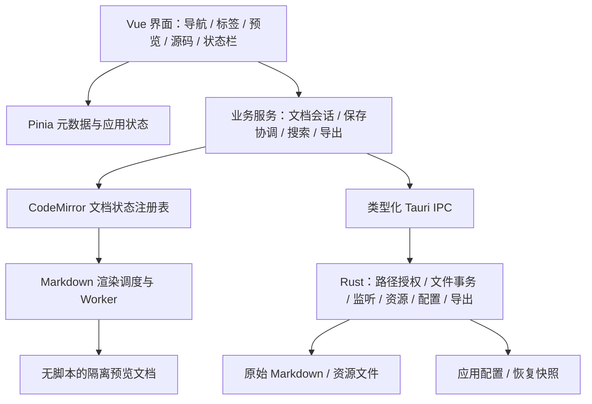

# Markdown Studio 技术设计文档（TDD）

| 项目 | 内容 |
| --- | --- |
| 文档版本 | V1.0 |
| 更新日期 | 2026-11-18 |
| 需求基线 | [PRD V1.0](./prd.md) |
| 设计与实施 | [UI/UX 设计规范](./ui-ux-design.md)、[开发任务清单](./task-list.md) |
| 当前仓库 | FND-01 已建立并验证 Vue / Tauri 工程；详见任务清单和 verification |
| 文档状态 | 工程基线已验证；文件、渲染、导出等方案与性能指标仍需相应任务验证 |

## 1. 目标、边界与技术决策

### 1.1 目标

构建运行于 Windows 10/11 的本地优先 Markdown 桌面应用，采用最左侧文件导航、中央左侧预览、中央右侧源码的布局。以用户原始 `.md` / `.markdown` 文件作为最终数据，保证编辑、预览、文件管理、搜索、目录、图片、公式、图表和导出形成完整工作流。

本设计优先解决文件保存可靠性、外部修改冲突、非可信 Markdown 渲染、长文档输入响应及 Windows 导出能力。应用不上传文档、路径、搜索索引或恢复快照，不包含遥测、账号和云端服务。

### 1.2 范围与后续版本

V1.0 完成 PRD 第 4–8 章适用于首版的功能，包括基础恢复、基本编辑器设置、基于内容块的滚动同步、网络资源控制及打印。V1.1 优化恢复管理、大文档、图片工作流和同步精度，并加入自定义快捷键；V2.0 再评估所见即所得、插件、自定义主题等。

本文补充的默认值、预算、接口和实现库属于技术设计决策，不代表已有实现或测量结果。所有依赖在项目初始化时选择相互兼容的稳定版本，提交 `pnpm-lock.yaml` 和 `Cargo.lock`，禁止运行时从 CDN 拉取渲染依赖。

FND-01 实施基线：Node 22.23.4、pnpm 11.25.0、Vue 3.5.45、Pinia 3.0.4、Vite 8.3.8、TypeScript 5.9.3、Tauri CLI 2.12.5 / Rust crate 2.12.7、Rust 1.95.0。锁文件固定完整解析结果。Windows 推荐 MSVC + Windows SDK；本机也已用 MinGW GCC 13.1、`x86_64-pc-windows-gnu` 构建并启动，GNU 产物须携带 `WebView2Loader.dll`。不据此宣称安装器或 Windows 10 已验收。

### 1.3 技术栈

| 层级 | 选型 | 责任 / 注意事项 |
| --- | --- | --- |
| 界面 | Vue 3、TypeScript、Vite | 单主窗口；设置和查看器用浮层，首版不强制引入路由 |
| 状态 | Pinia | 文档元数据、活动标签、工作空间、设置和 UI 状态 |
| 编辑器 | CodeMirror 6 | 独立文档状态、撤销历史、语法、搜索、格式命令 |
| Markdown | Markdown-it + 固定版本插件 | CommonMark 基础、GFM 常用扩展、脚注、行号映射 |
| 渲染扩展 | Shiki、KaTeX、Mermaid | 高亮、公式、图表；按需加载并隔离错误 |
| HTML 安全 | DOMPurify + 自定义白名单 | 原始 HTML、生成内容、SVG 分别制定规则 |
| 桌面 | Tauri 2、Rust、Windows WebView2 | 原生窗口、IPC、本地文件、打印导出 |
| Tauri 插件 | FS、Dialog、Store、Opener | 使用最小权限；文档读写统一进入 Rust 服务 |
| 系统补充 | Rust `notify`、`trash` 或 Windows 回收站 API、WebView2 Windows 绑定 | 文件监听、回收站、原生 PDF/打印；需原型验证 |
| 测试 | Vitest、Vue Test Utils、Rust tests、Playwright、Tauri Windows E2E | 单元、组件、渲染截图和真实桌面测试 |

不默认引入大型 UI 框架。使用小型可访问基础组件和统一 CSS 变量，实现黑白灰界面。`github-markdown-css` 可作为参考或受控依赖，不通过在线 CSS 控制应用外观。

## 2. 架构与模块边界

### 2.1 分层



### 2.2 责任划分

| 模块 | 责任 | 不承担的责任 |
| --- | --- | --- |
| `DocumentService` | 打开、切换、关闭、会话恢复、去重 | 不直接拼接文件路径或调用 FS 插件 |
| `EditorRegistry` | 每文档 `EditorState`、当前 `EditorView`、选择与历史 | 不将完整编辑状态做深层响应式代理 |
| `SaveCoordinator` | 800ms 防抖、revision、保存队列、关闭前检查 | 不绕过冲突状态覆盖文件 |
| `RenderScheduler` | 渲染版本、Worker、扩展缓存、旧结果丢弃 | 不允许 Markdown 调用 IPC |
| `SourceMapService` | 行号到块的映射、目录、滚动锚点 | 不通过纯百分比替代内容映射 |
| `WorkspaceService` | 工作空间、目录分页、文件操作、事件聚合 | 不随意递归系统目录 |
| `SearchService` | 文件名索引、流式全文搜索、取消与结果定位 | 不把全部文件常驻前端内存 |
| `ResourceService` | 图片解析、授权、复制、网络获取、资源 token | 不执行内容提供的 URL 或命令 |
| `ExportService` | 固定版本快照、HTML、原生 PDF/打印 | 不把导出结果写回 Markdown |
| `SettingsService` | 配置校验、迁移、主题、布局持久化 | 不将文档正文保存在普通设置文件中 |

### 2.3 工程目录

```text
paper-lei/
├── docs/                         # PRD、设计、任务与后续验证记录
├── src/
│   ├── assets/                   # 本地字体资源、图标、静态资源
│   ├── styles/                   # tokens、应用、Markdown、打印样式
│   ├── components/
│   │   ├── ui/                   # 对话框、菜单、按钮、分隔条
│   │   ├── layout/
│   │   ├── editor/
│   │   ├── preview/
│   │   ├── file-explorer/
│   │   ├── outline/
│   │   └── toolbar/
│   ├── editor/
│   │   ├── codemirror/
│   │   ├── markdown/             # parser、plugins、source-map
│   │   ├── renderers/            # Shiki、KaTeX、Mermaid 适配器
│   │   └── extensions/
│   ├── workers/                  # 解析、高亮、统计
│   ├── services/                 # 业务协调与 IPC 客户端
│   ├── stores/
│   ├── composables/
│   ├── views/
│   ├── types/                    # 应用类型、生成的 IPC 类型
│   └── utils/
├── src-tauri/
│   ├── src/
│   │   ├── commands/
│   │   ├── services/             # file、path、watch、resource、export
│   │   ├── models/
│   │   ├── platform/windows/     # 安全替换、WebView2、关联入口
│   │   └── lib.rs
│   ├── capabilities/
│   ├── Cargo.toml
│   └── tauri.conf.json
├── tests/
│   ├── fixtures/                 # showcase、安全、资源、性能样例
│   ├── integration/
│   ├── e2e/
│   └── visual/
├── package.json
├── pnpm-lock.yaml
└── vite.config.ts
```

## 3. 文档模型与状态管理

### 3.1 核心类型

以下是逻辑契约示意，正式接口须由 Rust schema 生成或通过契约测试约束，不能依靠前后端手工长期同步。

```ts
type DocumentId = string;
type Revision = number;
type SaveState =
  | 'untitled' | 'clean' | 'dirty' | 'queued'
  | 'saving' | 'conflict' | 'error' | 'readonly' | 'missing';

interface DiskVersion {
  fileId: string;          // 文件身份；用于识别替换、大小写与路径别名
  byteLength: number;
  modifiedNs: string;      // 避免 JS 整数精度损失
  contentHash: string;     // 原始文件字节的 BLAKE3 或等价强摘要
}

interface DocumentSession {
  id: DocumentId;
  fileToken: string | null; // Rust 维护的访问令牌；未命名为 null
  displayPath: string | null;
  title: string;
  revision: Revision;       // 每次内容事务递增
  savedRevision: Revision;  // 最近已确认落盘的快照版本
  diskVersion: DiskVersion | null;
  encoding: 'utf8' | 'utf8-bom';
  newline: 'lf' | 'crlf' | 'mixed';
  saveState: SaveState;
  conflictId: string | null;
  lastErrorCode: string | null;
}

interface SourceBlock {
  blockId: string;
  fromLine: number;         // 内部统一 0-based
  toLineExclusive: number;
  kind: string;
}

interface RenderResult {
  documentId: DocumentId;
  revision: Revision;
  renderEpoch: number;      // 主题、资源策略变化也使其递增
  safeHtml: string;
  blocks: SourceBlock[];
  outline: OutlineItem[];
  diagnostics: RenderDiagnostic[];
}
```

`OutlineItem` 包含层级、标题文字、唯一锚点、源码行及子节点；`RenderDiagnostic` 包含块 ID、严重程度和可读错误。渲染输出进入 DOM 前仍需经过安全装配边界，`safeHtml` 类型名不是信任依据。

### 3.2 数据权威与状态

- CodeMirror `EditorState.doc` 是活动编辑文本的权威来源；Pinia 不存第二份持续双向同步的大字符串。
- `EditorRegistry` 为每个标签保存独立状态，切换时复用一个活动 `EditorView`，避免所有标签持有完整 DOM。
- 保存、导出、解析读取不可变文本快照，携带 `documentId + revision`；状态栏和统计使用派生数据。
- `dirty` 以当前内容与最后确认保存快照比较，revision 用于顺序判断。撤销回保存内容后可恢复 clean，不能只用 `revision !== savedRevision` 判断。
- 文档身份基于后端文件 ID 与规范化路径，Windows 路径大小写、斜杠差异和同一文件重复打开不能产生重复会话。默认禁止跨授权边界跟随链接。
- 后台标签仍可保存；单个文档保存失败不能阻塞其他文档的队列。

### 3.3 保存状态流

```text
untitled --选择路径并保存--> saving --> clean
clean --内容事务--> dirty --800ms无输入--> queued --> saving
saving --成功且当前内容等于提交快照--> clean
saving --成功但有更新内容--> dirty --> queued
saving --失败--> error --用户重试--> queued
任意已命名状态 --检测到外部差异且有本地编辑--> conflict
conflict --重新加载--> clean
conflict --另存副本--> 新文件 clean；原文件冲突保留至明确处理
conflict --确认覆盖最新磁盘版本--> queued（携带新的预期版本）
任意已命名状态 --原路径消失--> missing（不自动重建）
```

只读、冲突、路径消失、错误状态暂停自动保存。普通保存错误不进行无限重试；用户重试或更换路径后再恢复。未命名草稿不触发原文件保存，但参与恢复快照。

## 4. 文件系统、保存与冲突

### 4.1 打开、编码和换行

1. 文件对话框、拖放和系统关联进入统一后端打开入口；只接受 `.md`、`.markdown`，大小写不敏感。
2. 校验路径和权限，读取字节、文件身份、时间与摘要；严格解码 UTF-8，识别并记录 BOM。
3. 非 UTF-8 返回 `UNSUPPORTED_ENCODING`，仅提供明确的只读查看或转换说明，禁止带替换字符的内容进入自动保存路径。
4. 记录每条换行边界的 LF/CRLF 信息和末尾换行状态。编辑器内部使用 LF，保存时恢复原边界；修改区域新增换行使用原文件主要样式，新文件默认 LF。
5. 混合换行文件保留未修改边界的格式；以变更映射维护换行元数据。实现复杂度必须通过专项测试确认，不能静默统一全文件换行。若该能力尚未就绪，先提示只读并允许明确转换后另存。
6. 文件只读、被占用、权限不足分别返回结构化错误，UI 保留可恢复内容。

### 4.2 保存协调

默认自动保存开启，停止输入 **800ms** 后执行。输入法组合期间不触发快照保存，`compositionend` 后重新计时。手动保存跳过防抖；全部保存并行调度不同文件，但同一路径串行。

每文件最多一个写入任务，排队区仅保留最新待保存 revision。若保存 A 期间又产生 B，A 完成只能更新 A 的保存基线，不能将 B 标为已保存；随后保存 B。前端定时器不替代后端互斥，Rust 按文件身份/目标路径统一串行化保存、重命名、删除。

### 4.3 安全写入与并发边界

保存请求必须携带 `expectedDiskVersion`。后端写入流程：

1. 获取文件操作互斥锁，重新验证访问授权、路径身份、文件状态和磁盘摘要；与预期不符立即返回冲突。
2. 把编辑快照按原编码和换行写入同目录唯一临时文件，写完后 flush / `sync_all`；不先截断原文件。
3. 再次校验目标文件身份与内容版本。新建文件采用“不覆盖已存在目标”的创建/提交语义。
4. 对已有文件，Windows 适配层使用已验证的替换 API，保留被替换原文件的唯一备份；不得使用“先删除原文件再 rename”方案。保留 ACL 等元数据的行为须实测。
5. 校验替换操作实际产生的原文件备份是否匹配预期版本，并确认写入结果。仅确认一致后返回成功和新 `DiskVersion`。
6. 若实际被替换版本不匹配，标记 `CONFLICT_DURING_COMMIT`，保留外部版本、编辑快照与原基线，立即提示用户。只有在能够确认不会覆盖更新版本的情况下才恢复外部文件；否则交由冲突界面处理，禁止报告“已保存”或删除备份。
7. 普通错误保留内存正文和必要快照，释放锁并返回明确错误；恢复文件在下次启动可识别，避免遗留临时文件无人处理。

**并发限制：**前后两次校验仍存在检查与替换间的竞态，普通文件系统 API 不提供通用的内容比较交换。不能把“mtime 检查 + rename”描述为绝对防覆盖。Windows 原型必须验证外部写入、外部原子替换、文件锁定和保存中崩溃；利用实际被替换的备份识别最后窗口的冲突，确保外部内容可恢复且冲突不被静默吞掉。不满足备份与验证能力的文件系统禁止静默降级保存，提示另存本地副本。

V1.0 完整保存保证以本地 NTFS 为验收基线；其他卷、网络共享、重解析点等须经过能力检测，未验证时只读打开并提示另存，不能宣称等价事务保证。防止竞态丢失是发布阻断项，而不是 V1.1 优化项。

FND-03 在本地固定 NTFS 卷验证了 `ReplaceFileW` + 唯一备份，比较实际备份的文件身份、修改时间、长度与 BLAKE3。相同内容但文件身份改变也会报告提交冲突。快照、候选文件及备份留在同卷事务目录；不自动回滚覆盖更新版本。[原型验收与限制](./verification/FND-03.md)。文件授权、同文件队列、正式恢复与清理仍需各自任务实现。

### 4.4 外部监听与冲突

使用 Rust 文件监听服务，监听工作空间和单文件所在目录，合并 150ms 内重复通知；应用获得焦点及每次保存前再校验，弥补事件丢失。自写事件通过写入事务 ID、文件身份和内容摘要判断，不能忽略固定时间窗口内所有通知。

- 无本地编辑且无待保存任务：读取新版本并重新加载，保留光标和阅读锚点；加载期间若产生新编辑，则转入冲突流程。
- 有本地编辑、保存排队或写入中：暂停该文件队列，生成包含 base/local/disk 的冲突会话。
- 对比界面 V1.0 至少提供本地与磁盘并排差异；保留 base 用于识别变化，自动三方合并不是首版要求。
- “保留当前内容”只保留 local，不能解除保存暂停；用户可另存副本。
- 明确覆盖时重新读取最新 disk 并绑定一次性的覆盖确认版本；此后 disk 再次变化仍返回冲突。
- 外部移动、删除和监听中断分别提示；路径消失时自动保存不得重建旧文件。

### 4.5 新建、重命名、删除

文件操作统一经过后端授权与路径校验。拒绝空名称、保留设备名、非法字符、尾随点或空格、路径穿越和同名覆盖；大小写重命名按 Windows 行为单独处理。

文件夹重命名需暂停受影响文档保存，完成后统一更新标签、收藏、最近记录、资源基准、监听和工作空间索引；失败回滚内存路径。移动/重命名后重新解析资源，不默认重写 Markdown 内部链接。

删除先统计目标内文件和目录数量，不跟随重解析点；处理所有受影响的未保存文档后，再按用户确认移至回收站。回收站不支持或失败时返回错误，不能改为永久删除。删除后的标签关闭或转为恢复草稿，取决于用户此前明确选择；收藏/最近记录标记失效。

## 5. 编辑器与实时渲染

### 5.1 CodeMirror 集成

按扩展组合 Markdown 语法、行号、折叠、缩进、括号/标记辅助、选区、搜索替换、历史、快捷键和主题。用 `Compartment` 切换字体、折行、主题等配置，不能重新创建整个编辑器导致历史丢失。

所有内容变化通过事务通知，更新 revision，并触发保存、预览和统计的独立调度。格式菜单将文本变更作为可撤销事务；预览任务复选框首版只读。中文输入法、Emoji、组合字符和多光标行为纳入测试。

字数口径：基于 Markdown 源码，逐个计数汉字，其他文本使用 `Intl.Segmenter` 的 `isWordLike` 词项，标点和空白不计字数；不能对同一汉字重复计词。字符数按 Unicode 码点统计，包含空白与换行。光标行号与面向用户的列号从 1 开始，列按 grapheme cluster 计数，Tab 作为一个逻辑字符。统计在 Worker 中延迟约 300ms 计算，旧 revision 结果丢弃。

### 5.2 渲染流水线

```text
CodeMirror 事务
  → 100ms 合并调度（输入法组合结束后）
  → Worker 解析 Markdown-it tokens + 源码行范围
  → 生成标题锚点 / 目录 / 块级中间表示
  → 代码高亮与公式处理；Mermaid 先生成占位
  → 主线程 DOMPurify 分策略净化与资源 URL 改写
  → 按 documentId + revision + renderEpoch 校验
  → 隔离预览文档的块级 DOM 更新
  → 可见图表渲染 / 图片加载 / 布局映射重算
```

Worker 只处理不依赖 DOM 的解析、高亮、统计等任务，DOMPurify 在拥有 DOM 的可信装配层运行。大型文本优先传递变更集；首次打开和导出才使用完整快照。渲染可被新版本取代，耗时 Worker 超预算可终止并重建；结果必须同时匹配文档、内容版本和渲染配置版本。

V1.0 允许在 Worker 全文解析，但显示层按顶层块更新。块指纹采用类型、内容摘要和重复序号生成稳定键；修订版本之间映射失效时恢复最近可靠锚点，不能把旧块位置强行用于新文档。缓存按主题、语言和内容哈希区分，设定 LRU 上限。

### 5.3 语法能力与插件

| 能力 | 方案 | 边界 |
| --- | --- | --- |
| 常见 Markdown | Markdown-it，显式设置 `html`、`linkify`、`breaks` | `breaks=false`，保留 Markdown 语义 |
| GFM | 内置表格/删除线，加任务列表与自动链接规则 | 对照固定 GFM 样例测试；不宣称完整复制 GitHub |
| 脚注 | 固定版本脚注插件 | 编号、返回链接、唯一 ID |
| 标题锚点 | 自有 slug 规则与冲突计数 | 支持中文、重复标题和特殊字符；与目录共用 |
| Shiki | 单例 highlighter，内置常见语言并按需加载 | 未知语言纯文本；语法样式使用受控 class 或属性 |
| KaTeX | 行内 `$...$`、块级 `$$...$$` 规则 | `trust=false`，限制展开；错误只影响公式块 |
| Mermaid | 固定版本、`securityLevel: strict`、禁用交互链接 | 支持 PRD 六类图表，复杂度限制和隔离渲染 |
| 原始 HTML | 开启解析后统一白名单净化 | 不支持任意脚本、样式、嵌入页面和表单 |

### 5.4 预览隔离与 DOM 更新

预览放在同源 `srcdoc` iframe，`sandbox` 只允许 `allow-same-origin`，不允许脚本、弹窗、表单、下载和顶层导航。可信父页面可访问其 DOM 以更新内容、监听点击、测量滚动；Markdown 本身没有执行脚本的能力。

预览文档使用更严格的 CSP：脚本和网络连接禁用，图片只允许受控 blob / data 或资源协议，样式和字体只允许打包资源及应用生成的受控样式。父窗口拥有的 Tauri 能力不会授予渲染内容。链接默认行为全部由可信事件处理器接管；过滤 `<base>`、meta refresh 和危险导航。

原始 HTML 不允许 `style`、任意 `class`、事件属性和伪造的 `data-source-*`。渲染器自己生成的源码映射、KaTeX class / MathML、Shiki 样式经过单独白名单装配，不能为了保留公式样式而给原始 HTML 开放同等权限。生成的 ID 统一前缀，防止 DOM clobbering。

Mermaid 需要脚本和 DOM，使用**独立的沙箱渲染页**，只加载打包脚本，不具有 Tauri IPC 能力；不与上述只读预览 iframe 共用脚本权限。输入使用结构化消息，校验发送窗口、一次性请求 token 和大小；生成的 SVG 再次净化后才进入预览。单图默认源码不超过 100KB、节点预算 500、时间预算 2s，超限显示源码和提示。隔离页超时可销毁重建；须在原型中验证恶意图表不会阻塞主编辑窗口，若 iframe 不能提供足够隔离，使用独立无权限 WebView。不能仅用无法中断同步渲染的 `Promise.race` 声称解决卡顿。

### 5.5 正文与打印样式

FND-05 确认 Mermaid 使用独立原生进程及独立 WebView2 用户数据目录，避免图表同步脚本阻塞主窗口；父级监督 2s 渲染预算，超时结束任务进程，不使用 `Promise.race` 充当中断。允许预热加载至 8s，30s 总看门狗。原型观察到 Tauri 内部对象仍会注入无 capability 的窗口，因此敏感 Rust command 必须核对窗口身份，不能把“没有全局对象”作为权限边界。正式服务需在 RENDER-03 中包装该边界，见[FND-05](./verification/FND-05.md)。

`src/styles/markdown.css` 按 UI/UX 第 4 章实现 GitHub 风格，限定 `.markdown-body`。明暗主题变量与代码主题分开管理，禁止外部内容覆盖全局 CSS。截图覆盖标题、引用、表格、任务列表、代码、脚注、HTML、公式和图表。

打印样式移除应用工具、代码复制按钮和滚动容器限制；正文使用浅色，图片不超过纸张宽度，表头可跨页重复，标题避免孤立于页尾。超长代码和表格允许合理分页，不能一律 `break-inside: avoid` 导致空白页；必要时在打印专用样式折行并记录差异。

## 6. 源码映射、目录与滚动同步

Markdown-it 块 token 的 `map` 是源码范围基础。段落、标题、列表、表格、代码、公式与图表生成受控 `blockId`，同时在可信映射表记录行范围。用户 HTML 提供的行号属性全部忽略。

### 6.1 源码到预览

1. 从 CodeMirror 可见区获取顶部源码行和该行的偏移。
2. 在块范围表二分找到对应内容块。
3. 读取预览块的几何位置，按块内相对位置做局部插值。
4. 无精确映射时退回最近标题或段落，不退回整篇滚动百分比。

### 6.2 预览到源码

点击普通内容时，从最近合法块获取起始行；可精确映射的文本再计算偏移。复杂图表、公式、HTML 定位至块起始。用户正在选中文字或点击互动元素时不定位；定位只改变选区，不修改内容。

滚动时用顶部可见块及块内偏移反向查找源码位置。使用来源标记、同步 token、`requestAnimationFrame` 合并和主动用户输入识别，避免程序滚动再次驱动另一侧。用户实际滚动优先于程序同步。

### 6.3 布局变化

通过 `ResizeObserver`、图片 load、字体 ready 和图表完成事件失效几何缓存。更新前记录 `(blockId, offset)` 锚点，更新后恢复。长文档可按块延迟挂载，未挂载部分保留高度占位；无法稳定估算时先减少高亮和图表渲染，不牺牲输入响应来追求全量预览。

目录直接来自解析 token，与预览使用同一锚点，避免二次解析不一致。支持 H1–H6、层级跳跃、重复标题、当前章节高亮和空目录状态。

## 7. 图片、链接与访问控制

### 7.1 文件授权模型

由 Rust 维护访问授权表：通过用户选择的单文件、工作空间根、保存目标和显式授权资源建立 token。IPC 只接受 token 与受校验的相对操作，不信任前端传入的任意绝对路径。

- 打开单文件授予该文件编辑权，以及文档所在目录内图片读取权，不授予整个磁盘写权限。
- 打开工作空间授予根目录内 Markdown 文件管理权和资源读取权；新增资源目录需用户选择或在已授权根内创建。
- 绝对图片、跨根 `../` 图片支持在用户明确授权后读取；不能因 PRD 支持绝对路径而放宽为全盘可读。
- 访问时规范化并检查最终路径，处理 Windows UNC、设备路径、ADS、大小写、符号链接与 junction；默认拒绝设备路径和越界重解析点。
- 对目录操作检查实际文件句柄/文件身份，减少校验后目录被替换带来的逃逸风险；协议 URL 不接受裸文件路径。
- 拒绝敏感系统/应用配置目录的文档资源读取；直接用户选择的合法文档操作与文档内自动资源访问使用不同策略。

### 7.2 图片加载

相对路径基于当前 Markdown 所在目录解析，绝不使用安装目录或进程工作目录。后端验证 MIME 与大小后返回短期资源 token，由受控资源协议或 blob 加载；关闭文档后撤销令牌和 blob URL。

支持 PNG、JPEG、GIF、WebP、SVG。SVG 采用禁止脚本、外部引用、`foreignObject` 的独立净化规则，再作为图片展示，不能把原始 SVG 直接注入主应用。文件移动后重建解析基准与资源缓存。

网络图片默认关闭；用户可为当前文档临时允许，并在设置中管理规则。由后端受控获取，不允许内容直接发起任意请求。仅允许 HTTP/HTTPS，拒绝 URL 内凭据、环回/私有/链路本地/保留地址，逐次检查 DNS 结果与重定向目标并约束实际连接地址，避免 DNS 重绑定绕过。最多 3 次重定向、10s 超时、单资源 20MB、单文档导出资源预算 100MB；不发送应用凭据、Cookie 或本地路径，结果按 MIME 校验。网络规则属于内容资源策略，不影响用户明确在系统浏览器中打开正常链接。

### 7.3 插入、查看与链接

拖图按用户选择引用原路径或复制到资源目录；先完成复制并验证，再以单次编辑事务插入 Markdown。资源重名生成不冲突文件名，不移动或删除原文件。复制成功但文档插入取消时，不静默清理用户资源，仅提示可能存在未引用文件。

锚点、脚注在文档内导航；相对 `.md` 链接通过同一打开服务处理，越界需授权。其他本地附件由用户明确点击并确认使用系统应用打开，可执行文件和脚本禁止由预览直接启动。HTTP/HTTPS 链接交给 Opener 在系统浏览器打开；禁用 `javascript:`、任意自定义协议和自动导航。`mailto:` 如需启用，作为独立受控协议并以用户点击为前提。

## 8. 工作空间、搜索与快捷命令

### 8.1 文件树与检索

目录按需列举，树视图虚拟化，仅载入展开节点；文件夹在前、自然排序。默认排除 `.git`、`node_modules`、`target` 等构建依赖目录，设置中可显示被忽略目录；隐藏/忽略策略在树、搜索、快速打开中一致。

后端构建轻量文件名索引，文件监听增量更新；不预建永久全文数据库。全局内容搜索按文件流式读取，仅搜索 `.md` / `.markdown`，默认字面关键词，不要求首版实现正则。200ms 防抖，每次请求带 `searchId`，新请求取消旧任务。

结果包含文件 token、显示路径、行号、匹配范围和摘要，以批次事件返回。单次默认最多 2000 条，达到上限明确标记截断。扫描默认跳过大于 10MB 的文件并提示，可由用户对本次搜索显式包含；不能静默漏检。权限错误作为部分诊断展示。

打开标签的搜索以当前内存文本覆盖对应磁盘结果，并标记“未保存内容”；后台扫描使用请求开始时的快照版本，点击结果时若文档变化需重新定位或提示。未命名文档属于当前文档搜索，不属于工作空间搜索。

### 8.2 命令系统

以 `CommandId` 注册名称、执行器、可用条件和快捷键。菜单、工具按钮、右键和键盘共用注册表。范围依次为顶层弹窗、编辑器、活动文档、应用，避免重复触发。

快捷键完全遵循 UI/UX 第 7 章，尤其 `Ctrl+B` 切换导航、`Ctrl+Shift+S` 全部保存、`Ctrl+P` 快速打开、`Ctrl+Shift+P` 打印。不得让 CodeMirror 默认绑定覆盖产品命令；输入法组合、文本框和原生对话框要正确处理。

## 9. 配置持久化与恢复

使用 Tauri Store 在应用配置目录保存经过 schema 校验的 JSON，路径由平台 API 获取，不硬编码用户名。配置分组包含：

| 数据 | 内容与规则 |
| --- | --- |
| `settings` | `schemaVersion`、主题、字体、行高、编辑器、布局、保存、资源策略 |
| `session` | 窗口位置、大小、标签路径、活动文档、工作空间和阅读锚点 |
| `recent` | 最近 50 个文件；按最后打开时间排序，可清空 |
| `favorites` | 用户收藏，显式增删，路径失效仍可修复 |
| `recovery` | 独立草稿文件与索引，不嵌入普通配置 JSON |

配置写入防抖 500ms，原子提交并保留上一份有效版本。Store 插件是否满足原子写入须验证，不满足则由 Rust 包装；损坏配置备份后回退默认并提示。schema 升级执行可测试迁移。窗口恢复需检查当前显示器工作区，避免窗口落在已移除显示器外。

恢复服务每次停止输入 2s 后保存脏文档快照；持续输入时最多间隔 10s。快照包含内容、revision、原路径、磁盘基线和时间，仅保存在本机应用数据目录，使用当前用户 ACL。每文档保留最近 3 份；已解决快照保留 7 天后清理，未解决冲突和草稿不自动删除，空间不足时提示并停止增加快照。

正常保存后可标记对应快照已解决；用户明确放弃才标记废弃。退出失败、异常终止和下次恢复都不能自动将快照覆盖到原路径。恢复目标是减少损失，不承诺进程崩溃前最后一个按键必然持久化。

## 10. HTML、PDF 与打印

### 10.1 统一导出快照

导出针对当前编辑器内存 revision，包括未保存修改，不要求先覆盖原文件。冻结文本、主题、阅读配置和资源策略，使用与预览相同的解析、净化及样式。未命名文档的相对资源缺少基准时明确提示并允许选择资源基准目录。

导出任务等待代码、公式、图表、字体和授权图片处理完成，默认准备超时 30s。失败项列入诊断，由用户明确选择继续占位导出或返回修复；不能将超时当作完整成功。导出文件写入临时目标后提交，不覆盖原 Markdown，已存在的导出目标需系统保存对话框确认。

### 10.2 HTML

生成含 UTF-8、标题、viewport、内嵌样式与安全正文的完整文档，不携带 Tauri IPC、应用菜单或用户脚本。KaTeX CSS/字体、代码样式和净化后的 Mermaid SVG 随导出打包，不依赖 CDN。

默认单文件：允许资源按预算转为 data URI；超过预算时提供 HTML + 同名资源目录，所有引用改写为相对路径。目录写入同样需授权、避免覆盖同名文件；生成临时资源目录，失败时只清理本次创建内容。网络资源只使用已获准获取的内容。

“复制渲染 HTML”生成同样净化的正文片段，写入 `text/html` 与纯文本回退；“复制 Markdown”复制当前源码快照。剪贴板只由明确命令触发，不能由文档内容自动读取或写入。

### 10.3 Windows PDF 与打印

**主要方案：**建立不具有通用文件系统/Opener 权限的专用导出 WebView，加载可信模板和净化后的静态正文。通过 Windows 专用 Rust 适配层调用当前 WebView2 SDK 支持的 `PrintToPdf` / `PrintToPdfStream`；原生打印使用对应打印 UI API。具体接口版本与 Tauri/Wry 句柄访问方式必须在早期原型中确认。

PDF 默认 A4、纵向、16mm 页边距，可选 Letter / 横向；生成时禁用脚本与网络，不依赖系统默认打印机。导出完成验证文件存在、大小合理、可被 PDF 阅读器打开，再提示成功。打印取消返回 `cancelled`，不记为错误。

不能把浏览器 `window.print()` 的“Microsoft Print to PDF”作为唯一 PDF 导出实现：它依赖系统配置且不能提供可靠的保存路径、完成状态与错误处理。若 WebView2 桥接不可行，必须在正式导出开发前完成替代方案评审并更新本文；不能静默增加 Chromium 大体积依赖或把 PDF 功能推迟至下一版。

专用 WebView 仅有一次性完成事件权限，核对窗口 label、任务 ID 与 nonce；不对内容暴露 `save_document` 等业务命令。完成或取消后清理本次临时资源，保留必要的错误诊断。

FND-04 实机确认 `with_webview` → `ICoreWebView2_7::PrintToPdf` 与 `ICoreWebView2_16::ShowPrintUI(SYSTEM)` 可用。PDF 回调同时检查 HRESULT 与成功标志；取消是丢弃临时输出，不承诺中止 WebView2 内部工作。系统打印 UI 不提供用户完成/取消的回调，打开窗口不得当作已打印；正式打印若需可靠提交状态，须使用应用控制的确认流程并调用带状态的原生打印 API。详见[原型证据](./verification/FND-04.md)。

## 11. IPC 契约与安全边界

### 11.1 主要命令

下表为逻辑接口，最终 Rust 命名与字段可细化，但语义需保持一致。

| 命令 | 输入核心字段 | 输出 / 行为 |
| --- | --- | --- |
| `choose_and_open_documents` | 原生选择选项 | 授权并返回文档 token、文本和 `DiskVersion` |
| `open_document` | 已授权 file token | 文本、编码、换行元数据、文件状态 |
| `choose_workspace` | 原生选择 | 工作空间 token 和根节点 |
| `list_directory` | workspace token、目录 token、分页参数 | 节点与游标，不越权遍历 |
| `save_document` | file token、文本、revision、expected version | 新版本或冲突；同文件串行 |
| `save_document_as` | 文档快照、原生保存结果 token | 新 file token；不信任任意路径 |
| `create_entry` | parent token、名称、类型 | 新节点或名称错误 |
| `rename_entry` | entry token、新名称 | 受影响路径映射；禁止覆盖 |
| `inspect_delete` / `trash_entry` | entry token / 删除确认 token | 数量预览 / 回收站结果 |
| `resolve_resource` | doc token、引用、授权上下文 | 资源 token 或需授权 / 禁止原因 |
| `copy_image_resource` | 源选择 token、目标目录 token | 安全相对引用 |
| `search_workspace` / `cancel_search` | workspace token、query、searchId | 流式结果与结束事件 |
| `resolve_conflict` | conflictId、处理动作、确认的 disk version | 重新加载 / 副本 / 受版本约束覆盖 |
| `start_export` / `cancel_export` | revision 快照、格式、选项、目标 token | exportId、进度、完成结果 |

### 11.2 事件与错误

事件包含 `workspace:changed`、`file:changed`、`search:batch`、`search:finished`、`export:progress`、`export:finished`。每个事件携带会话/任务 ID，前端销毁时取消订阅，旧工作空间事件不得更新新工作空间。

统一错误结构：`{ code, message, retryable, operationId, details }`。至少区分 `NOT_FOUND`、`PERMISSION_DENIED`、`PATH_OUT_OF_SCOPE`、`INVALID_NAME`、`ALREADY_EXISTS`、`UNSUPPORTED_ENCODING`、`READ_ONLY`、`DISK_FULL`、`FILE_BUSY`、`CONFLICT`、`CONFLICT_DURING_COMMIT`、`RESOURCE_BLOCKED`、`RENDER_TIMEOUT`、`EXPORT_FAILED`、`CANCELLED`。日志默认只记错误码、耗时和任务 ID，不记录正文、完整路径或资源 URL 中的敏感参数。

### 11.3 Tauri 权限

- 主窗口只拥有必要 commands、Dialog、Store、受控 Opener 与剪贴板能力；不用通配的文件系统权限。
- FS 插件不向渲染内容暴露任意读写；敏感文件操作始终经过 Rust 业务服务的运行时授权。
- 未授权窗口、远程来源、沙箱渲染页不能调用业务 IPC。Capabilities 之外，敏感 command 还检查调用窗口与会话 token。
- 打包环境关闭开发服务器和生产不需要的调试入口，设置最小 CSP；生产安全测试必须使用打包后的权限和协议配置。
- 原始 Markdown、文件名、搜索结果、诊断信息都按不可信内容处理，UI 使用文本节点，禁止直接拼接进模板、脚本或命令行。

## 12. 性能预算与降级

以下为待验证的初版目标，不是现有跑分。基准机器暂定 Windows 11、4 核 CPU、16GB RAM、SSD、1920 × 1080、100% DPI，使用 release 构建并记录 CPU 型号、WebView2 版本与依赖版本。Windows 10 另测兼容性；CI 虚拟机数据仅观察趋势，不直接替代实机门槛。

| 项目 | 目标 / 测量方式 |
| --- | --- |
| 冷启动 | 从进程启动到可操作窗口 ≤ 3s；连续 20 次，报告中位数与 P95 |
| 1MB 打开 | 从读取开始到源码可编辑 ≤ 500ms，首次有效预览 ≤ 1s |
| 1MB 输入 | 从输入到编辑器呈现 P95 ≤ 50ms；200 次真实输入采样 |
| 普通文档预览 | ≤ 1MB、纯文本/常规代码，最后输入后 P95 ≤ 200ms，包含 100ms 合并时间 |
| 5MB / 10MB 打开 | 源码可编辑分别 ≤ 1.5s / 3s；首屏基础预览 ≤ 3s / 5s |
| 5MB / 10MB 输入 | 启用降级后输入延迟 P95 ≤ 80ms，不因预览全量工作持续阻塞主线程 |
| 工作空间 | 10,000 个文件，根级目录首次可操作 ≤ 1s；展开按需加载 |
| 搜索 | 10,000 文件、约 100MB 文本，首批结果 ≤ 1s；总耗时如实记录，支持取消 |
| 长时间编辑 | 30 分钟编辑、切换和资源加载后内存无持续增长趋势；关闭文档释放缓存 |

自动保存不含磁盘耗时的触发点为最后输入后约 800ms；统计、恢复、搜索各自调度，不能共享一个防抖器。解析、高亮缓存初始总预算 64MB，图片 blob 缓存初始 128MB，按 LRU 回收并根据实测调整。

大于 5MB 自动进入轻量预览：减少离屏 DOM、延迟图表、限制超长代码块高亮；单代码块超过 200KB 默认纯文本。大于 10MB 显示大文档提示，允许仅源码模式；不因降级改变文件内容或禁用必要保存。1MB、5MB、10MB 样例分别准备纯文本、代码密集和图表/图片混合版本，结果分别报告，不能用纯文本跑分代表所有语法。

## 13. 测试、验收与发布

### 13.1 测试分层

| 层级 | 重点 |
| --- | --- |
| 单元 | 路径规范化、授权、编码/混合换行、revision、保存队列、源映射、slug、配置迁移 |
| Rust 集成 | 临时目录真实写入、故障注入、只读/满盘模拟、外部竞态、回收站、监听 |
| 渲染 | GFM、脚注、KaTeX、Mermaid、HTML/SVG 净化、恶意 URL、样式隔离 |
| 组件 | 标签状态、菜单禁用、错误持久提示、焦点管理、冲突选择 |
| 浏览器 E2E | 编辑预览、搜索、主题、分栏、样式截图；使用受控 IPC mock |
| Windows 桌面 E2E | 真实 IPC、文件选择、关联、拖放、保存、回收站、PDF、打印、安装 |
| 人工 | 中文输入法、Narrator、DPI、多显示器、打印结果和长文档滚动 |

浏览器 mock 测试通过不能代表 Tauri 权限、文件系统与 Windows 导出通过。原生对话框难以稳定自动化的部分使用可重复的人工脚本并记录结果。

### 13.2 必须覆盖的失败场景

保存中继续输入、两个连续 Ctrl+S、保存与重命名竞争、外部修改发生在校验后、外部删除、ACL 变化、磁盘满、文件占用、监听丢失、非 UTF-8、BOM、混合换行、重名和大小写路径；渲染旧结果晚到、图表死循环/超限、净化绕过、越界资源、恶意 SVG、网络重定向；导出取消、资源未就绪、应用异常关闭和恢复。

### 13.3 构建与发行

CI 使用 Windows runner 执行前端格式/lint/typecheck/单元测试、Rust fmt/clippy/test 和 release 构建。自动化检查脚本统一收敛到 `pnpm check` 等入口，具体命令由工程初始化落实。

V1.0 首发 Windows x64 NSIS 安装包；如需要 MSI，另行验证 WiX 流程后追加。通过安装配置注册 `.md` / `.markdown` 的“打开方式”，不强制抢占系统默认应用。支持冷启动参数打开和已运行实例转交，先验证 Tauri single-instance 插件或等效 Windows 机制。

目标系统基线暂定 Windows 10 22H2 与 Windows 11 的受支持构建，最终以选定 Tauri/WebView2 组合验证结果冻结。检测 WebView2 Runtime，优先使用受支持的 Evergreen Runtime；安装器明确在线安装依赖或提供离线方案，禁止缺少运行时后静默退出。

发行前检查安装、卸载、升级保留配置、卸载不删除用户 Markdown 与资源。公开发布需完成签名流程与许可证清单；无签名的内部测试包必须明确标记，不能宣称已完成发行签名。版本更新检查和自动升级不属于 V1.0 必需范围。

### 13.4 发布门槛

PRD AT-01 至 AT-15 全部通过，UI/UX UX-01 至 UX-11 有验收记录；无未解决的数据丢失、越权读取、脚本执行或核心流程崩溃问题。性能偏离目标必须有复测与处理结论，不能直接把失败项改成通过。任务与验收追踪详见任务清单第 5 节。

## 14. 早期验证与风险处置

| 编号 | 风险 / 未验证假设 | 验证与关闭条件 |
| --- | --- | --- |
| R-01 | Tauri 2 下 WebView2 PDF/打印 API 桥接 | 实机生成含中文、表格、公式、图表的多页 PDF；明确取消、错误与安装依赖 |
| R-02 | Windows 安全替换与外部竞态 | 故障注入证明三版本可恢复、冲突被报告、原文件不被截断；明确支持卷范围 |
| R-03 | HTML / KaTeX / SVG 与 iframe 安全策略兼容 | 合法样例可读，恶意脚本/导航/越权被拦截，渲染页无法 IPC |
| R-04 | Mermaid 隔离是否保护输入响应 | 超大和无效图表下主编辑器仍响应；必要时改独立无权限 WebView |
| R-05 | 10MB 解析、IPC 复制和 DOM 成本 | release 实机基准达标，明确降级与缓存上限 |
| R-06 | GitHub 风格在 Windows 字体/DPI 下偏差 | 固定截图基线覆盖浅深主题、中英文与 100%–200% DPI |

上述风险作为任务清单中的早期验证任务和发布阻断项管理。实现中若调整平台能力、权限模型或版本范围，需同步修改本 TDD、UI/UX 对应行为和任务验收条件，不以单个代码提交替代设计变更记录。
